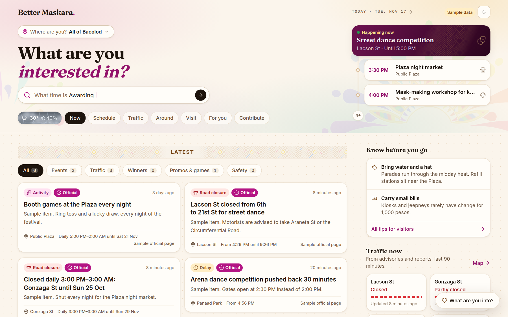
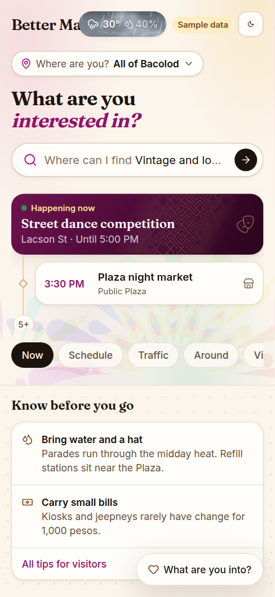
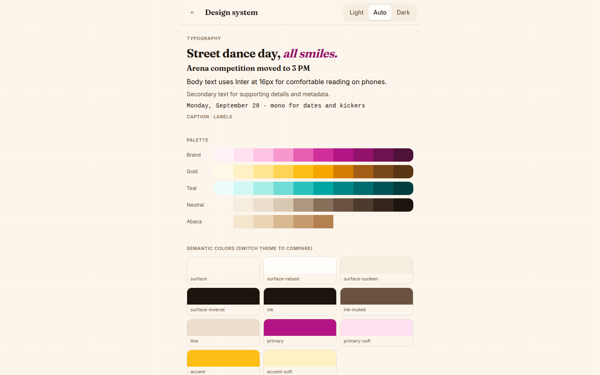
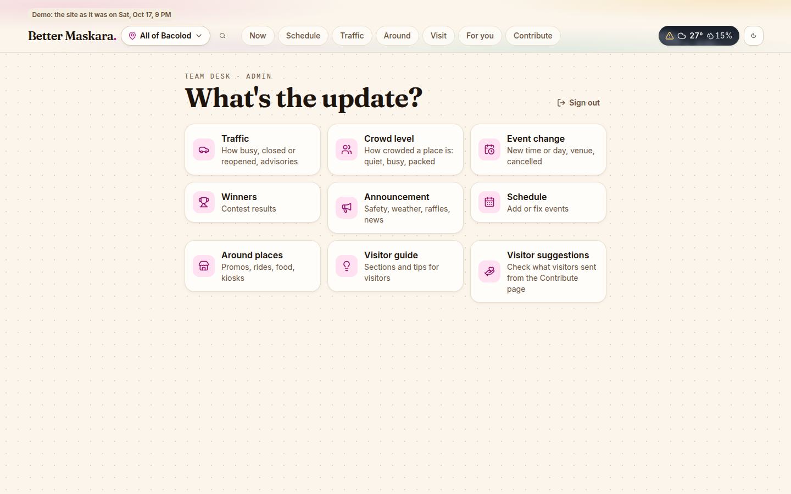
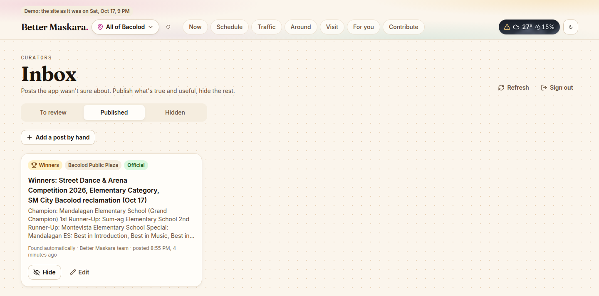
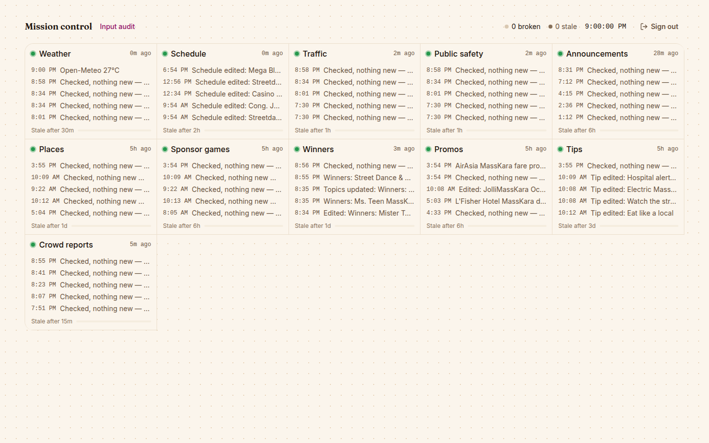
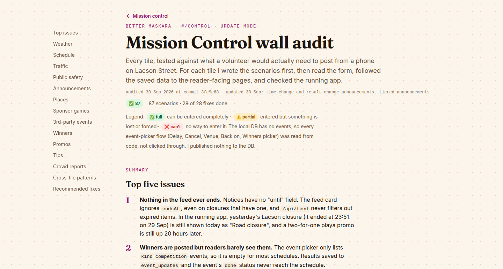

# Better Masskara

An AI agent driven social media aggregator for events at the MassKara Festival in Bacolod: it gathers schedule changes, traffic, promos, safety and winners from Facebook, X and other pages for three festival weeks, at [bettermasskara.com](https://bettermasskara.com).

| Desktop | Mobile |
| --- | --- |
|  |  |

## About this repository

This is a fresh public release. The earlier history lived in a private repo because it contained non-public production domains and IP addresses, so this public repo starts from a clean commit. The full history stays private and is available to walk through on request, just ask.

## What it does

Four proactive AI bots (Grok) run the feed:

* a lead that keeps the plan and the wake-ups
* a specialist for the schedule
* a specialist for traffic
* a specialist for promos and places

The bots gather posts from Facebook, X and other pages and push them into the site through the API. Posts go to one of two endpoints, and both store the sender with the post:

* monitoring team members (collectors) push the posts they find, each with their own token, to `POST /api/ingest/posts`
* bots and authors post finished copy through the curator inbox, `POST /api/control/posts`, where a rule classifier files it straight away

Every 15 minutes an ingest pass pulls the weather from Open-Meteo and runs the classifier over the posts people sent in. The feed, schedule, traffic map and Around places then read the same Postgres database.

**Status:** the bots ran live through 18 October 2026. The site is quiet now and launches publicly at next year's festival. The bots run on their own infrastructure and their code is not in this repo; see "Posting and editing" below for how to set up your own.

## Stack

React 19 + Vite 8, Tailwind CSS v4 with its own design system (`src/ui`, tokens in `src/index.css`), lucide-react icons, Hono API (`server/`), Drizzle ORM + Postgres. 37 SQL migrations. Tests are Vitest (`*.test.ts` files across `server/` and `src/`).

The design system has a living preview at `/#/design`:



## Run locally

```sh
npm install
cp .env.example .env          # set DATABASE_URL to any Postgres
npm run db:migrate            # applies server/db/migrations
npm run db:seed               # Bacolod area gazetteer
npm run dev:api               # API on http://localhost:8787/api, runs the ingest pass every 15 min
npm run dev                   # web app on http://localhost:5173
```

Without the API the web app shows clearly labeled sample data.

## Tests

```sh
npm test          # vitest run over every *.test.ts file
npm run typecheck
```

## Demo mode

Pin the site to Saturday 17 October 2026, 9 PM in Bacolod: the clock is frozen, the API is read-only and ingest is off.

```sh
npm run demo:db   # clone masskara into masskara_demo, prune after the pin, add that night's weather (needs Docker)
npm run demo:api  # API on http://localhost:8788
npm run demo:web  # build and preview at http://localhost:5182
```

`demo:db` uses the local `masskara-pg` container and never writes to `masskara`. Content created after the pin is deleted, `/api` answers every write with 403, and the web build shows a demo notice. `DEMO_NOW` turns the server on and `VITE_DEMO_NOW` the web build; with them unset, nothing changes.

Production is pinned the same way, against the real database and with no pruning: the image build in `.github/workflows/deploy.yml` passes `VITE_DEMO_NOW` and `DEMO_NOW` (`2026-10-17T21:00:00+08:00`), so the deployed clock is frozen, the feed stops at the pin, `/api/weather` serves the snapshot in `server/data/demo-weather.json`, writes answer 403 and ingest is off. To return to the live clock, delete those two lines from the workflow's `build-args` and redeploy; an empty value means off.

## Posting and editing

The posting side is maintained by the four Grok bots described above, and the bots are not part of this repo. What ships here is the site and the API they post through. To run your own bot or script on your own infrastructure, point it at your own API URL and use the two endpoints below; section 6 of `docs/ARCHITECTURE.md`, "Posting through the API (agents and scripts)", covers the calls, token setup and the rules around areas, place kinds and topics.

The ingest pass runs every 15 minutes. Locally the API runs it in process when one is due; set `INGEST_TIMER=off` when something else runs it. `npm run ingest` runs one pass now.

Add a post through the curator inbox (it is classified straight away):

```sh
curl -X POST localhost:8787/api/control/posts \
  -H "authorization: Bearer <staff token>" -H "content-type: application/json" \
  -d '{"text":"TRAFFIC ADVISORY: Lacson St closed to vehicles\nFrom 6th to 21st St."}'
```

Monitoring team members (collectors) push posts with their own token:

```sh
npm run collector:add -- "Maria"   # prints the token once
curl -X POST localhost:8787/api/ingest/posts -H "authorization: Bearer <token>" \
  -H "content-type: application/json" \
  -d '{"posts":[{"platform":"facebook","url":"https://facebook.com/...","author":"MassKaraFestivalBacolod","text":"...","postedAt":"2026-10-04T09:30:00+08:00"}]}'
```

The team can use screens instead of curl. They are not linked from the public nav; share the links:

* `/#/team`: the team desk. Post closures, traffic levels, event changes, winners and announcements, and edit the schedule, Around places (with a map pin) and the visitor guide's tips. Area pickers search the list and can add a new area on the spot. Team members and staff both use it with their own token.



* `/#/inbox`: curators publish, hide or fix posts the classifier was unsure about. Staff only (`ADMIN_TOKEN` also works). Publishing verifies the item, so it shows as "Verified by staff".



Each person has one token, which every team page accepts and the device remembers once.

## Mission control

Mission control (internal, see `docs/MISSION_CONTROL.md`) is at `/#/control`: a wall with one tile per data group, green, gray (stale) or red (broken). **Watch** shows what each group last got; **Update** turns each tile into buttons that open the right desk form. Staff and team members sign in with their own token (team members land in Update and see no flags); `ADMIN_TOKEN` also works, watch only. Below the wall, the intake table (or graph) lists what came in and what it became. "Preview with sample data" shows the wall without a server.



The Input audit page (`/#/audit`) reviews every group's forms against what a volunteer needs to post from their phone:



```sh
npm run staff:add -- "Maria"   # prints the token once
curl localhost:8787/api/control/board -H "authorization: Bearer <token>"     # group health, activity, used/ignored
curl localhost:8787/api/control/sources -H "authorization: Bearer <token>"   # fetcher and collector health
```

## Deploy

The GitHub Actions workflow in `.github/workflows/deploy.yml` runs the tests, builds a Docker image from the repo's `Dockerfile` and deploys it: the API and the built site run in one container behind Caddy, with the database env in `.env` (see `deploy/Caddyfile`, `deploy/masskara-api.service`, `deploy/backup.sh`).

The API is also portable to Cloudflare Workers, configured in `wrangler.toml`: `server/worker.ts` serves the API and runs the ingest pass from the cron there, and the web app is built separately.

```sh
npx wrangler secret put DATABASE_URL        # also ADMIN_TOKEN and TURNSTILE_SECRET
npm run db:migrate                          # then deploy straight away: new code expects the new schema
npm run deploy:api
npm run dev:worker                          # local Worker; curl localhost:8787/__scheduled runs the cron
```

## Project layout

```
src/
  ui/            design system components (Badge, Button, Card, Chip, SectionHeader)
  components/    app components (SiteHeader, FeedCard, TrafficStrip, NowView)
  lib/           shared types, API client, category metadata, helpers
  data/sample.ts placeholder content for offline development
server/
  app.ts         Hono API (portable: Cloudflare Workers, Vercel, Node)
  node.ts        local Node entry (API + ingest timer)
  worker.ts      Cloudflare Workers entry (API + ingest cron)
  db/            Drizzle schema, client, 37 migrations, seed
  ingest/        weather (Open-Meteo), rule classifier, the ingest pass and its scheduler
  items/         item actions (verify, hide, edit) shared by mission control, the inbox and the desk
  control/       mission control groups and feeds, fetcher registry, board, inbox and sources queries
```

## Docs

* `docs/ARCHITECTURE.md`: sources, data model, API endpoints, hosting, roadmap. Section 6, "Posting through the API (agents and scripts)", is the starting point if you add an agent or script that posts.
* `docs/DESIGN_SYSTEM.md`: tokens and components, live at `/#/design`
* `docs/FIRST_IMPRESSION.md`: the feature list and what a first visit should feel like
* `docs/MISSION_CONTROL.md`: the internal health wall
* `docs/TOPICS_PLAN.md` and `docs/BRAND_MASSKARA.md`: the topics layer and the festival brand

If you add a missing area, place kind or topic through the API, add it instead of working around it, and report a gap only when no call there can carry the post.
